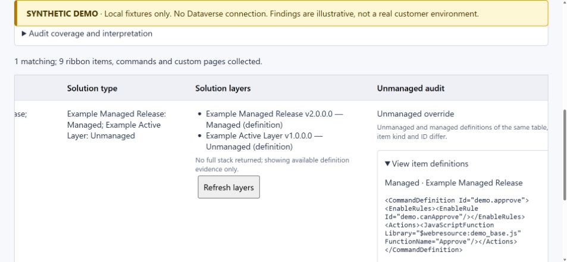

# Dataverse Ribbon and Command Audit Explorer

**A community developer preview for investigating unmanaged command metadata in inherited Dataverse environments.** Maintained by [Osazee Odigie](https://github.com/GodChosen).

You inherit a Dynamics 365 environment, decide to deploy managed solutions going forward, and discover that nobody knows which tables contain old ribbon customizations. This tool brings accessible evidence into one review table: classic buttons, standalone command/rule definitions, hide actions, modern commands and custom pages.

> **Evidence, not a clean-production certificate.** An unmanaged definition without a returned managed baseline is a **creation candidate**, not a confirmed creation. An empty layer response is inconclusive. The tool never removes customizations.



_Local fixtures only: no customer environment, production records or independent endorsement._

## What it helps you answer

- Which returned ribbon items have unmanaged evidence, including commands and rules that do not create a new button?
- Can an existing managed/OOB button be affected by an unmanaged command or rule?
- Which same-item managed/unmanaged definitions differ, and which definitions can I inspect?
- Which solutions contain an item, what are their management states, and what layers did the service return?
- Which tables had no returned definitions and therefore still need follow-up?

The scanner reads the accessible table roster and all pages of the ribbon source collections without asking you to select tables. Global/null context is included as the Application Ribbon. This **does not guarantee complete layer history or coverage of every table's hidden/unpublished ribbon state**.

## Try it without a tenant

Requires Node.js within the supported engine ranges in package.json: 20.19+, 22.13+, or 24+.

```sh
git clone https://github.com/GodChosen/powerpages.git
cd powerpages/dataverse-ribbon-audit-explorer
npm ci
npm run demo
```

Open `http://127.0.0.1:4175/demo/index.html`, select **Scan / rescan**, then filter **Unmanaged audit**. The fixture transport rejects non-demo destinations; the server binds to loopback. Nothing is imported into Dataverse.

## Install in Dataverse

1. Read [installation](docs/INSTALLATION.md) and [known limitations](docs/LIMITATIONS.md).
2. Verify and import the [managed 1.5.1 preview](releases/DataverseRibbonAuditExplorer_1.5.1_managed.zip) into a sandbox first. The [unmanaged package](releases/DataverseRibbonAuditExplorer_1.5.1_unmanaged.zip) is for source development.
3. Configure app sharing in your environment and confirm source **1.5.1**.
4. Scan, review findings and layer status, and export results plus table coverage. Validate findings against Command Checker/exported RibbonDiffXml before considering cleanup.

The public release has automated fixture tests and source/package verification. The sanitized 1.5.1 package **has not completed an independent fresh-environment import test**. Earlier private 1.5.0 runtime observations are recorded separately; they are not certification of this package. See [validation](docs/VALIDATION.md).

## Reading the results

| Finding                                         | What the evidence supports                                                                          |
| ----------------------------------------------- | --------------------------------------------------------------------------------------------------- |
| Unmanaged override                              | Same table, element kind and item ID have differing unmanaged/managed definitions.                  |
| Unmanaged creation candidate                    | Unmanaged definition exists; no same-item managed baseline was returned.                            |
| Unmanaged duplicate                             | Observed unmanaged definitions match observed managed definitions.                                  |
| Affected by unmanaged command/rule              | A button references a command/rule with unmanaged evidence.                                         |
| Unmanaged hide action                           | An unmanaged hide definition identifies a target control.                                           |
| Unmanaged layer over managed component          | Both management states were observed for a modern component; field differences are not established. |
| Unmanaged ribbon parent — review required       | Parent is unmanaged; that flag alone establishes no individual button change.                       |
| Not verified / No unmanaged definition observed | Evidence is insufficient to certify absence of unmanaged customizations.                            |

**Membership, origin and active-layer evidence are different concepts.** Default Solution membership does not prove an unmanaged override. OOB origin does not guarantee that a referenced command/rule is clean. Read [classification](docs/CLASSIFICATION.md).

## Documentation

- [Installation and permissions](docs/INSTALLATION.md)
- [Architecture and data flow](docs/ARCHITECTURE.md)
- [Classification and evidence contracts](docs/CLASSIFICATION.md)
- [Review workflow and export fields](docs/REVIEW_WORKFLOW.md)
- [Validation and reproducible checks](docs/VALIDATION.md)
- [Limitations and roadmap](docs/LIMITATIONS.md)
- [Contributing and expert review](CONTRIBUTING.md)
- [Security and data handling](SECURITY.md)
- [Release notes](CHANGELOG.md) and [package checksums](releases/checksums.json)
- [Authorship and contribution record](AUTHORS.md)

## Build and review

```sh
npm run check
npm test
npm run test:demo
npm run docs:check
npm run release:verify
npm run format:check
```

Rebuild both packages with PowerShell and Microsoft Power Platform CLI:

```powershell
./scripts/build-release.ps1
```

The build stages files under ignored `artifacts/`, verifies package contents, and performs no authentication, import or publishing. [Release procedure](docs/RELEASING.md).

## Community review

Please [open an issue](https://github.com/GodChosen/powerpages/issues/new) with a sanitized reproduction, version, evidence and expected classification. Reviews of false positives, missed customizations and platform-version compatibility are especially useful. No independent expert approval or multi-tenant compatibility is claimed yet.

[MIT license](LICENSE), scoped to this directory. Microsoft product names are descriptive; this is an independent community project.
