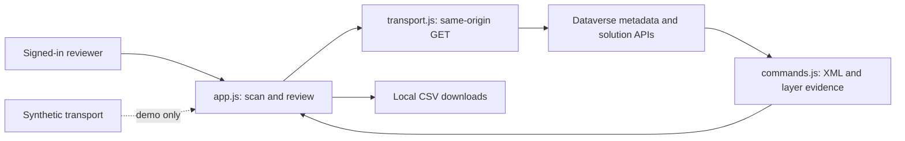

# Architecture and data flow

The runtime is six static web resources. There is no application server, local database, telemetry collector or runtime npm dependency. Development dependencies support tests, formatting and package verification only.

| Module                 | Responsibility                                                                                                   |
| ---------------------- | ---------------------------------------------------------------------------------------------------------------- |
| index.html / style.css | Controls, sortable table, coverage details and horizontal scrolling.                                             |
| app.js                 | Orchestration, joins, filtering, sorting, 50-row pagination, layer/dependency actions and exports.               |
| transport.js           | Same-origin GET, continuation links, bounded transient retries and cancellation.                                 |
| commands.js            | Classic/modern parsing, item grouping, classification and layer normalization.                                   |
| core.js                | Keys, protected CSV and retained helpers from the earlier explorer. Some exports are not used by the focused UI. |

## Sources

- EntityDefinitions supplies table logical names/IDs, not business records or every table's attributes.
- ribbondiffs, ribboncommands, ribbonrules and ribboncustomizations are read without table/solution filters, with paging. Their accessibility/schema is a compatibility assumption; these reads do not guarantee complete effective ribbon history.
- appaction/canvasapp readable columns are discovered through metadata; custom pages require CanvasAppType 2.
- solutions supplies names, versions, publishers and management states. solutioncomponents joins exact object IDs in batches of 25; nearby tables/scripts do not establish ownership.
- msdyn_componentlayers uses component ID plus logical component name. Unmanaged findings request layers automatically; other rows are on demand. A virtual-provider response is evidence, not a certified complete stack.
- Targeted web-resource reads resolve referenced script IDs. Platform dependency functions supplement supported rows. Standalone classic audit rows expose definition references; a command/rule GUID is not assumed to be a RibbonDiff component type 55.

## Failure and comparison behavior

Classic source failures remain independent. Continuation URLs must stay on the same origin under `/api/data/v9.2/`; credentials, fragments and repeated links are rejected. Transient 429/502/503/504 responses have at most four attempts. Retry-After above 60 seconds stops that request. Batch concurrency is four; there is no global request-budget guarantee.

Canonical XML comparison sorts attributes and ignores formatting whitespace while preserving child order and meaningful values/text. It is not runtime equivalence. Discovered scripts and formula bodies are never executed. DTD/entity declarations and malformed XML are rejected; metadata is rendered through text nodes.

Provider order is preserved within a component, not combined across physical IDs into a fabricated stack. Only summaries and matching item XML attributes are retained from layer JSON, not the entire raw payload.

Scan data lives in page memory; reload discards it. CSV is downloaded on request, never uploaded. Dependencies are static references, not execution/deletion-safety proof. The synthetic transport/server is separate from deployed resources. See [security](../SECURITY.md) and [classification](CLASSIFICATION.md).
